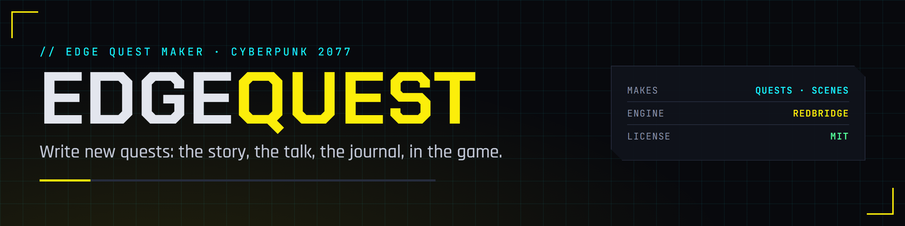
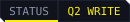
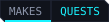

  

  
  
  
  
  

The EDGE quest maker for Cyberpunk 2077, a VS Code extension in the EDGE family. Open any of the game's quests and read it in plain words: its steps, its choices, who says what, what goes in the journal. Then write your own: a new gig, a phone call, a conversation with a choice that matters. Or skip the UI: EDGEquest's MCP server lets REDagent or Claude do it when you say "add a side gig where Wakako sends V to collect a debt".

EDGEquest builds on the other EDGE tools: [REDcode](https://github.com/Edgemodders/REDcode) for the project and packing, [REDbridge](https://github.com/Edgemodders/REDbridge) for game files, [EDGEwave](https://github.com/Edgemodders/EDGEwave) for voice, [EDGEbuilder](https://github.com/Edgemodders/EDGEbuilder) for people and places in the world, and [EDGEdeck](https://github.com/Edgemodders/EDGEdeck) and [REDnode](https://github.com/Edgemodders/REDnode) to try the quest in the game.

**[Read the docs](https://edgemodders.github.io/EDGEquest/)** &middot; [Design](docs/design.md) &middot; [Dev setup](docs/dev-setup.md)

> [!NOTE]
> **Status: scaffold.** The repository, the branding, the docs site and a design brief (draft 0.1) exist; there is no code yet. Next: Q0, the design.

## Repository layout

| Path | Contents |
|---|---|
| `docs/` | Documentation site: the design and dev setup |
| `tools/brand/` | Renders the banner, icon and badges; `activity.svg` is the activity bar icon |

## Legal

EDGEquest is MIT. Like REDcode, it talks to REDbridge (GPL-3.0, because it links WolvenKit) only as a separate process and never links it. This repository contains no game files and no data extracted from them. Single-player modding only. EDGEquest is not affiliated with CD Projekt RED.

## License

[MIT](LICENSE)
