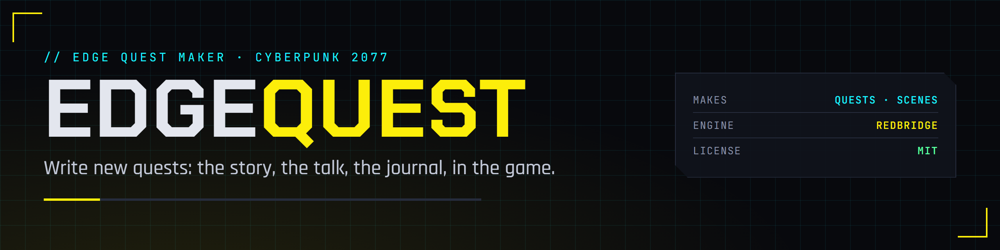

# EDGEquest for Cyberpunk 2077

**[Docs](https://edgemodders.github.io/EDGEquest/)** · [Repo](https://github.com/Edgemodders/EDGEquest) · [Issues](https://github.com/Edgemodders/EDGEquest/issues) · [Nexus Mods](https://www.nexusmods.com/cyberpunk2077/mods/35750)



EDGEquest is the EDGE quest maker for Cyberpunk 2077. Open any of the game's quests and read it in plain words: its steps, its choices, who says what, and what goes in the journal. Then write your own quest as a short story, and EDGEquest makes the game's quest files from it.

> **Preview.** What is here works and is tested in the game. New features land in small updates. Please report problems on [GitHub](https://github.com/Edgemodders/EDGEquest/issues).

**What you need**
- Windows, and Cyberpunk 2077 2.5 (Steam, GOG or Epic).
- [REDcode for Cyberpunk 2077](https://marketplace.visualstudio.com/items?itemName=edgemodders.redcode-cyberpunk). It finds the game, installs REDbridge (0.11.0 or later) and the .NET 10 runtime, and packs and installs your quest. EDGEquest reads and writes game files through REDbridge.
- [ArchiveXL](https://www.nexusmods.com/cyberpunk2077/mods/4198) in the game, for the quests you make.
- Optional: [EDGEwave](https://marketplace.visualstudio.com/items?itemName=edgemodders.edgewave) to find, hear and make sounds, and [REDnode](https://github.com/Edgemodders/REDnode) to hear music in the running game.

## Read the game's quests

Click the EDGEquest icon in the activity bar.

| View or command | What it does |
|---|---|
| **Game Quests** | Every quest, phase and scene in the game, in folders titled with their quest's name |
| **Find Quest...** | Search by in-game title, file name, fact, journal entry, person or place |
| The quest page | A quest or phase as numbered steps in plain words, with its facts, journal entries, scenes, phases, people and places. The phases and scenes it plays are links. **Raw** opens the file in REDcode |
| The scene page | Who is in a scene, each line with its speaker and text, and each choice and where it leads |
| **Check Quest Mod...** | Checks a quest mod's `.archive`, WolvenKit project or extracted files, and names what is wrong in plain words |

## Write a quest

**New Quest...** asks for a title and an id, writes a story file (`<id>.quest.yaml`) in your WolvenKit project, and opens it on the **Storyboard**. A story is a set of beats. Each beat has a journal objective and steps, and a choice in a scene can send the quest to another beat:

```yaml
quest: Something at the Door
id: door_mystery
author: yourname
type: side
description: Go home and see what happens.

places:
  home:
    marker: quests/minor_quest/mq055_romance_apartment/01_megabuilding/judy_megabuilding/apartment

beats:
  go_home:
    objective: Go to your apartment
    marker: home
    steps:
      - arrive: home
  at_home:
    objective: You're home
    steps:
      - music: mus_q104_drone_flight_01_START
      - scene: at_the_door
  look_closer:
    objective: Look at the door
    steps:
      - music: mus_q104_drone_flight_02_STOP
      - done

scenes:
  at_the_door:
    - V: Home. Something feels different.
    - choice:
        Look closer:
          - sound: sa_airdrop_package_land
          - go: look_closer
        A payment:
          pay: 500
          then: []
```

- **The Storyboard** shows the beats as cards, with arrows labelled by the choice that leads there. Click a card for its page: its steps, its scenes' lines and choices, and how each line is spoken. Every change goes into the story file, comments kept.
- **Saving makes the quest:** the quest phase, the journal, the scenes, the texts and the `.archive.xl`. Problems show in the Problems panel at their line. Then pack and install with REDcode.
- **Places** are map markers the game already has. `arrive:` waits until V is inside the place's trigger area, as the game's own quests do.
- **Choices** can be yellow (they move the quest on), white, for one lifepath, an attribute check (`check: { body: hard }`) or a payment (`pay: 500`).
- **Music and sound:** `music:` starts or stops one of the game's music cues, `sound:` plays a sound event, in a beat or between a scene's lines. The picker searches the game's sounds and your project's own (made with EDGEwave), with a play button. Music plays in the running game.
- **The checklist** under `todo:` in the story file lists what is still a stand-in, such as lines not voiced yet, with the EDGE tool that can do it.

## Commands and settings

| Command | What it does |
|---|---|
| **EDGEquest: New Quest...** | Starts a quest from the template in the open WolvenKit project |
| **EDGEquest: Open Storyboard** | Opens a story file on the Storyboard |
| **EDGEquest: Make Quest** | Makes the quest's game files now |
| **EDGEquest: Made Files...** | The game files made from a story; a phase or scene opens in plain words |
| **EDGEquest: Find Quest...**, **Open Quest** | Finds and opens a game quest's page |
| **EDGEquest: Check Quest Mod...** | Checks a quest mod's files |
| **EDGEquest: Set Game Folder**, **Rebuild Quest Index**, **Refresh**, **Show Log** | The game folder, the quest index, the views, and EDGEquest's log |

| Setting | Default | What it does |
|---|---|---|
| `edgequest.makeOnSave` | on | Makes a quest each time its story file is saved |
| `edgequest.author` | (asked once) | Your modder name: a quest's files go in `mod\<author>\<id>` |
| `edgequest.gamePath` | REDcode's | The Cyberpunk 2077 folder |
| `edgequest.bridgePath`, `edgequest.dotnetRoot` | REDcode's | Where REDbridge and .NET 10 are |

## For assistants

EDGEquest's MCP server, [edgequest-mcp](https://www.npmjs.com/package/@edgemodders/edgequest-mcp), gives AI assistants such as Claude Code the same quest maker: read and find the game's quests, start a quest, edit its story, make it, and read its checklist.

## Legal

EDGEquest is MIT licensed. It talks to REDbridge (GPL-3.0, built on WolvenKit) only as a separate process. It contains no game files and no data extracted from them. Single-player modding only. Not affiliated with CD Projekt RED. Bundled packages keep their own licenses (`ThirdPartyNotices.txt`).
